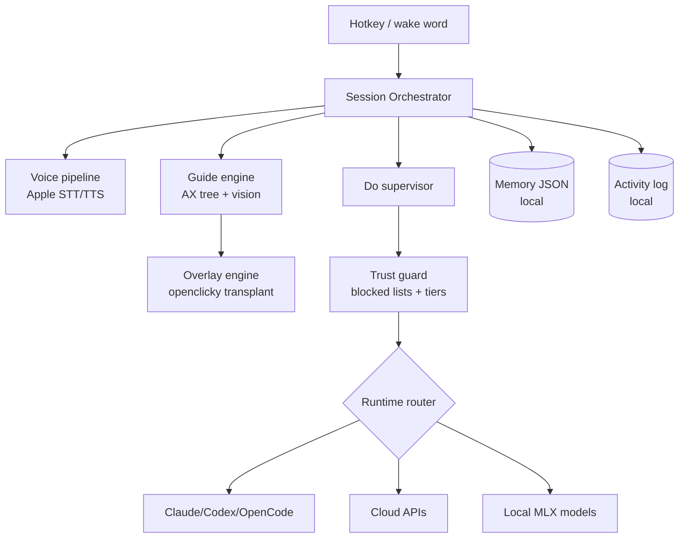
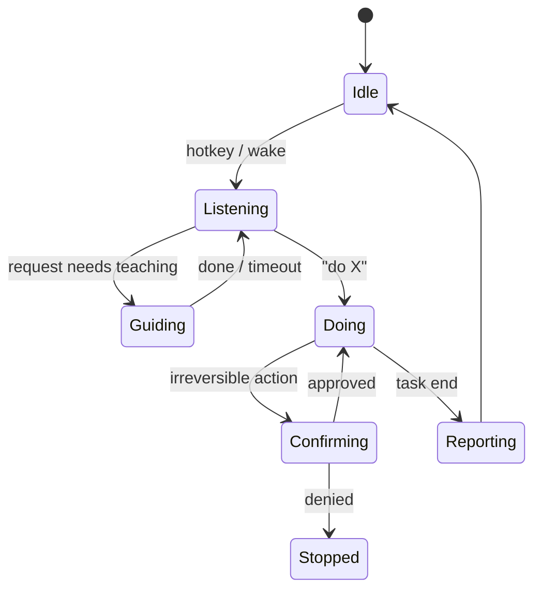

# Perry — PRD & Spec

**Date:** 2026-08-25
**Status:** Approved draft
**Platform:** macOS (v1)
**Distribution:** Free open client, bring-your-own compute

A screen-aware companion that teaches you any app by pointing and drawing on your screen, and can take the whole task off your hands.

## 0. Why the name

Perry the Platypus, from Phineas and Ferb (2007–2015 plus revivals): a family pet who is secretly a mission-running agent. The name encodes the product's two faces — the idle buddy who sits by your cursor, and the operative who takes whole tasks off your hands when dispatched. "Send Perry to do it" is dispatch language built into the name, and everyone aged roughly 18–35 already knows the reference without explanation. It's a common given name, so trademark exposure stays minimal.

## 1. Why this exists

Three products define the space:

- **Cursorly** (Windows) reads the accessibility tree instead of screenshots and stages Point → Ask → Do, but only Point ships and it's type-first.
- **HeyClicky** (macOS) proved demand: ~25k users, $0/$20/$100 tiers, voice-first, draws annotations on screen, spawns background agents. Its author open-sourced the original core ([farzaa/clicky](https://github.com/farzaa/clicky), MIT, 7.4k stars) then went closed on new features.
- **[jasonkneen/openclicky](https://github.com/jasonkneen/openclicky)** (MIT, active) extended clicky into agent territory but grew into ~90k lines of Swift with a 16,341-line `CompanionManager.swift` holding 541 functions and ~2% test coverage.

The gap: nothing combines consumer-grade charm, a serious trust model, and freedom from subscription lock-in. Perry takes heyclicky's warmth, Cursorly's safety posture, and openclicky's proven internals, rebuilt around a tested core.

Build strategy: **organ donor**. Fork openclicky, transplant the proven internals (overlay engine, screen capture, permission flows, CLI process spawning), delete the monolith and its satellite features, rebuild orchestration and UX cleanly.

## 2. Who it's for

Primary: prosumers inside dense tools (DaVinci Resolve, FL Studio, Excel, Figma) who want to both learn the tool and skip busywork. Secondary: developers, one toggle away.

Design bar: a non-technical family member must survive onboarding unaided.

## 3. Product principles

1. The buddy never lies about capability. If your Mac can't run something well, the product says so plainly.
2. Nothing happens without the hotkey or an explicit opt-in wake word. No ambient watching, ever.
3. Irreversible actions get exactly one clear confirmation. Everything else flows.
4. Your keys, your machine, your data. Cloud is opt-in per provider; local is experimental and honest about quality.
5. Playful when teaching, silent and precise when acting.

## 4. Feature specification (v1.0)

### Invocation

Global hotkey wakes Perry near your cursor. Optional wake word ("hey Perry"), off by default, uses Apple Speech on-device recognition. Type or talk each session; both co-equal day one via free Apple frameworks (Speech.framework STT, AVSpeechSynthesizer TTS). Premium voices become BYOK upgrades later.

### Guide mode (default resting state)

- Step-follows-you teaching: point at control 1, wait while you act, detect the screen changed, point at control 2.
- "Show me everything" paints the full annotated path at once (numbered markers + arrows on a transparent overlay).
- Works from screenshots plus the accessibility tree where available. AX gives exact element frames and labels; vision fills gaps in canvas-style apps like FL Studio.
- Screen reading happens only while a session runs.

### Do mode (hands-off autonomy)

- Spawned by saying "Perry, do X" or picking Do from the panel. Runs in background; buddy docks to menu bar with live status; notification on completion or stop.
- Trust tiers gate actions (section 7). Every action lands in a live Activity Log (what, target window, timestamp, reversible?).
- Blocked-window check runs before any read or act (banking, password managers, checkout).

### Capability ladder (runtime adapters)

One `AgentRuntime` interface, four implementations:

1. **Coding-agent CLI (default):** Claude Code SDK path from openclicky, plus Codex CLI and OpenCode adapters. User's installed CLI and auth; zero extra setup beyond granting permissions.
2. **BYOK cloud:** Anthropic/OpenAI/OpenRouter/Gemini keys in Keychain, encrypted under the user's account. Computer-use against screenshots for GUI-heavy targets.
3. **Local experimental:** quantized UI-TARS-class models via MLX/llama.cpp. Gated by hardware probe: enabled only where projected latency and accuracy pass our floor (target: ≥M-series with 16GB+ unified memory for 4–7B quantized). Optimization budget: MLX quantization, speculative decoding, KV-cache reuse, prompt caching, batched AX-tree context to shrink image tokens. Below the floor, the tier shows "This Mac can't run this well" with specifics, never a broken experience. Custom endpoints stay configurable for people who insist.
4. **Custom:** any Anthropic-compatible or OpenAI-compatible base URL.

Adapter selection per task type: CLI runtimes handle file/dev/browser tasks natively; GUI-grounding routes to vision-capable runtimes. Switching is one picker in settings; the ladder auto-recommends based on what's installed.

### Memory (opt-out, not opt-in)

On by default because recall compounds value, fully configurable: per-category toggles (app workflows learned, preferences, past sessions), stored locally as an inspectable JSON file, one-click wipe, never synced. Off = goldfish mode, cold start every time.

### Confirmation UX

For irreversible acts (delete, send, purchase, overwrite): Perry highlights the exact target element and floats an inline intent card ("About to move 34 files to Trash · Approve / Stop") answerable by click or hotkey; a spoken line accompanies it. Voice-only confirmation never suffices for tier-red actions.

### Form factor

Buddy sprite appears near your pointer whenever a task runs (smooth choreography from openclicky's overlay engine), retreats to menu bar when idle. No notch dependency.

### Personality

Named companion, restrained: encouraging micro-copy while guiding ("this one, next to the red slider"), terse status while acting ("moving files… done"). No joke spam during Do. Copy voice documented in a tone sheet inside the repo.

### Onboarding

First run: permission walkthrough (Accessibility, Screen Recording, Microphone) with why-we-need-it cards, runtime auto-detect (finds installed CLIs), one guided demo task (Finder rename), wake-word offer. Under two minutes to first magic moment.

### Settings surface

Runtimes & keys, memory toggles, wake word, guardrail list viewer (read-only, signed file), activity log export, voice packs, hotkey remap.

## 5. Explicitly out of scope (v1)

Google Workspace/gogcli agents, notch UI, widgets, head gestures, Windows/Linux builds, team/cloud accounts, hosted inference, billing. Post-1.0 plugin territory.

## 6. Architecture



The Session Orchestrator is new code: a small, tested state machine replacing CompanionManager.



**Transplants from openclicky (~15–20k lines):** OverlayWindow choreography, CompanionScreenCaptureUtility, ExternalControlBridge HTTP server (kept internal), permission probes, CodexProcessManager process-spawn patterns.

**Deleted wholesale:** notch stack, widgets, gogcli integration, Nodex head gestures, reminder systems, onboarding music.

Runtime adapter interface sketch:

```swift
protocol AgentRuntime {
    var id: String { get }
    var capabilities: RuntimeCapabilities { get } // guiGrounding, fileIO, browser, latencyClass
    func plan(goal: String, context: ScreenContext) async throws -> Plan
    func execute(_ step: Step, consent: ConsentHandle) async throws -> StepResult
}
```

ScreenContext bundles AX snapshot (element roles, labels, frames) + screenshot reference id; the trust guard sits between plan and execute.

## 7. Trust & safety

Tier model applied at execution time:

| Tier | Actions | Behavior |
|---|---|---|
| Green | Read-only: move pointer, highlight, read window | Autonomous |
| Yellow | Reversible writes: typing, clicking, creating files | Autonomous, logged |
| Orange | Send email/message, delete to Trash, overwrite | One inline confirmation |
| Red | Empty trash, purchases, credentials, shell outside workspace | Confirm + typed-path display |

Always-blocked regardless of tier: banking/password-manager/checkout windows (Cursorly's published list as starting set); screen capture of those windows refused at the capture layer.

Prompt-injection defense carried over from openclicky's hardening passes: page/window content is untrusted input, never instructions; no arbitrary-JS eval tools; SSRF guards; sandbox defaults workspace-write.

## 8. Privacy & data flow

Screenshots exist in memory only during a running session; never written to disk unsanitized, never synced. Memory + activity logs are local JSON files, user-inspectable, wipeable. Keys in Keychain. No telemetry in v1 except explicit, opt-in crash reports. BYOK calls go device → provider directly; no proxy middleman (unlike clicky's Worker pattern).

## 9. Visual & interaction language

Transparent ink-on-glass aesthetic inherited from the overlay engine: high-contrast marker strokes, soft shadows, one accent color. Motion: pointer glides with spring easing (existing choreography), annotations draw themselves in ~200ms, intent cards scale in at the target. Reduced-motion respected. Buddy sprite: simple geometric character, 3 idle animations, states readable at a glance (listening pulse, thinking shimmer, acting focus ring).

## 10. Milestones (demo-gated, no calendar)

1. **Skeleton:** fork cleaned, orchestrator state machine with tests, overlay + capture transplants building, CLI runtime adapter driving one scripted Finder task end-to-end.
2. **Guide:** step-follows-you working across 5 target apps (Finder, Preview, System Settings, Excel, DaVinci), voice loop on Apple STT/TTS, "show me everything".
3. **Do supervised:** trust tiers enforced, intent-card confirmations, activity log, one real-world task suite green.
4. **Hands-off:** background execution, completion notifications, wake word, memory on.
5. **Ladder:** BYOK adapters, hardware probe, local tier behind Experimental flag on qualifying machines.
6. **1.0 polish:** onboarding, tone-passed copy, performance pass, demo video that doesn't embarrass us. Launch license chosen by then (AGPL-3.0 recommended to keep future hosted options open; MIT acceptable).

## 11. Risks

- **God-object gravity:** any transplant that drags CompanionManager dependencies in dies in review. The rule: transplants compile against new code only, never against the monolith.
- **Local-model disappointment:** mitigated by the honest hardware gate rather than marketing promises.
- **macOS API churn** (AX, ScreenCaptureKit across OS updates): pin to stable APIs, maintain an OS-compat test matrix.
- **Upstream divergence:** we're organ donors, not trackers; no rebases planned.
- **Name/legal:** Perry is a common English given name; the platypus association is referential, not claimed as a mark. Run a clearance check before launch anyway. Alternates recorded during naming research: Matilda, Colette, Shuri.

## 12. Open decisions deferred deliberately

License at launch, pricing/hosted tier (revisit with users), domain + social handles for Perry, wake-word phrase tuning, Windows port.
