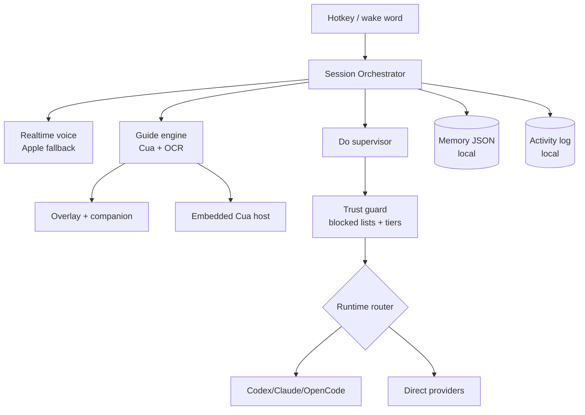
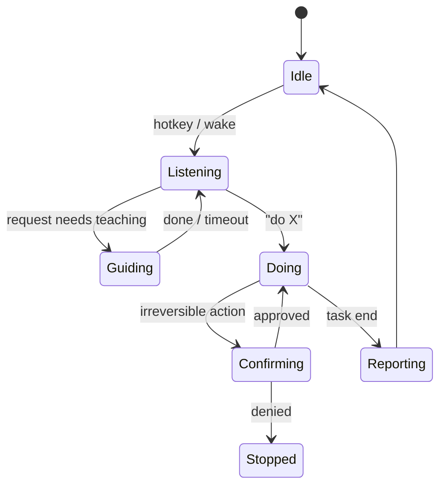

# Perry product contract

**Date:** 2026-08-25
**Status:** Approved 1.0 contract
**Platform:** Apple Silicon macOS 14+
**Distribution:** Free open client, bring-your-own compute

A screen-aware companion that teaches you any app by pointing and drawing on your screen, and can take the whole task off your hands.

## 0. Product identity

Perry is an original desktop companion with a spatial mint-and-ink identity. The product does not present itself as, or use artwork from, an existing entertainment character. The name still supports the product's two modes: Perry can guide you through a task or carry out a supervised task for you.

## 1. Why this exists

Three products define the space:

- **Cursorly** (Windows) reads the accessibility tree instead of screenshots and stages Point → Ask → Do, but only Point ships and it's type-first.
- **HeyClicky** (macOS) proved demand: ~25k users, $0/$20/$100 tiers, voice-first, draws annotations on screen, spawns background agents. Its author open-sourced the original core ([farzaa/clicky](https://github.com/farzaa/clicky), MIT, 7.4k stars) then went closed on new features.
- **[jasonkneen/openclicky](https://github.com/jasonkneen/openclicky)** (MIT, active) extended clicky into agent territory but grew into ~90k lines of Swift with a 16,341-line `CompanionManager.swift` holding 541 functions and ~2% test coverage.

The gap: nothing combines consumer-grade charm, a serious trust model, and freedom from subscription lock-in. Perry uses the audited competitor journeys as a minimum bar, but its production architecture is independently maintained and tested.

## 2. Who it's for

Primary: prosumers inside dense tools (DaVinci Resolve, FL Studio, Excel, Figma) who want to both learn the tool and skip busywork. Secondary: developers, one toggle away.

Design bar: a non-technical family member must survive onboarding unaided.

## 3. Product principles

1. The buddy never lies about capability. If your Mac can't run something well, the product says so plainly.
2. Screen capture starts only for an explicit session. Ambient wake is a separate remembered microphone mode with a permanent visible indicator.
3. Irreversible actions get exactly one clear confirmation. Everything else flows.
4. Your keys, your machine, your data. Cloud is opt-in per provider; local is experimental and honest about quality.
5. Playful when teaching, silent and precise when acting.

## 4. Feature specification (v1.0)

### Invocation

The global hotkey wakes Perry near your cursor. Optional ambient wake is off by default and runs only when Apple Speech supports on-device recognition; otherwise Perry reports that it is unavailable. Typed input and push-to-talk remain available. Configured realtime speech-to-speech is the primary duplex path, with Apple transcription and synthesis as the local fallback.

### Guide mode (default resting state)

- Step-follows-you teaching: point at control 1, wait while you act, detect the screen changed, point at control 2.
- "Show me everything" paints the full annotated path at once (numbered markers + arrows on a transparent overlay).
- Uses exact-window images, accessibility data, and local OCR obtained through the embedded Cua boundary. Optional direct providers can reason over an image when the user starts a grounded task.
- Screen reading happens only while a session runs.

### Do mode (hands-off autonomy)

- Spawned by saying "Perry, do X" or picking Do from the panel. Runs in background; buddy docks to menu bar with live status; notification on completion or stop.
- Trust tiers gate actions (section 7). Every action lands in a live Activity Log (what, target window, timestamp, reversible?).
- Blocked-window check runs before any read or act (banking, password managers, checkout).

### Capability ladder (runtime adapters)

Perry separates planning, execution, and verification capabilities. One typed registry records each provider's installation identity, authentication, confinement, supported operations, health, and measured latency.

1. **Bundled Codex (default):** pinned by version and checksum, with planning confined to read-only mode and execution confined to a selected workspace.
2. **Installed CLIs:** Claude and OpenCode use official login flows. Planning is available only after Perry verifies the exact executable; delegated execution stays disabled until its isolation and receipt gates pass.
3. **Direct providers:** OpenAI, Anthropic, Gemini, and OpenRouter credentials live in Keychain. These providers plan screenshot-grounded actions; Perry's supervised local executor performs them.
4. **Custom endpoints:** OpenAI-compatible HTTPS endpoints, with plaintext allowed only on explicit loopback addresses.
5. **Local experimental:** shown only when a model has an implemented adapter and the current Mac passes its disclosed hardware floor. An unavailable model is never presented as ready.

Routing uses the task's required capabilities and the user's preference. Perry records the selected provider and explains every fallback.

### Memory

Memory starts only after explicit onboarding consent. App workflows, preferences, and past sessions have separate controls. Records stay in a locally inspectable store and can be erased by category or in full.

### Confirmation UX

For irreversible acts (delete, send, purchase, overwrite): Perry highlights the exact target element and floats an inline intent card ("About to move 34 files to Trash · Approve / Stop") answerable by click or hotkey; a spoken line accompanies it. Voice-only confirmation never suffices for tier-red actions.

### Form factor

Buddy sprite appears near your pointer whenever a task runs (smooth choreography from openclicky's overlay engine), retreats to menu bar when idle. No notch dependency.

### Personality

Named companion, restrained: encouraging micro-copy while guiding ("this one, next to the red slider"), terse status while acting ("moving files… done"). No joke spam during Do. Copy voice documented in a tone sheet inside the repo.

### Onboarding

First run: permission walkthrough (Accessibility, Screen Recording, Microphone) with why-we-need-it cards, runtime auto-detect (finds installed CLIs), one guided demo task (Finder rename), wake-word offer. Under two minutes to first magic moment.

### Settings surface

General, Voice & Input, Runtimes, Integrations, Memory & Privacy, Appearance, and Safety & Advanced. Controls report unavailable or unverified states instead of presenting setup as success.

## 5. Explicitly out of scope (v1)

Notch UI, cloud accounts, billing, hosted inference, Windows/Linux, proactive cloud agents, hosted region routing, and a hosted skills marketplace. Slack, Notion, Linear, and Google Workspace are the direct-auth integration set for 1.0.

## 6. Architecture



`SessionController` owns the typed application session state. Application lifecycle code composes voice, guide, execution, integration, persistence, Cua, and overlay workers without owning their policy.



The embedded Cua host is the sole production computer-control and operating-system capture boundary. Perry retains OCR, geometry, guide reasoning, overlays, and in-memory image transforms. It does not ship a competing ScreenCaptureKit control stack or an internal HTTP control bridge.

Runtime boundaries:

```swift
protocol TaskPlanner {
    func plan(goal: String, context: ScreenContext) async throws -> Plan
}

protocol ActionExecutor {
    func execute(_ step: Step, consent: ConsentHandle) async throws -> StepResult
}

protocol ActionVerifier {
    func verify(step: Step, result: StepResult, context: ScreenContext) async -> VerificationStatus
}
```

External planner output is parsed once into supported actions and fails closed when an action name, target, parameter, scope, or verification requirement is missing. The trust guard sits between planning and execution.

## 7. Trust & safety

Tier model applied at execution time:

| Tier | Actions | Behavior |
|---|---|---|
| Green | Read-only: move pointer, highlight, read window | Autonomous |
| Yellow | Reversible writes: typing, clicking, creating files | Autonomous, logged |
| Orange | Send email/message, delete to Trash, overwrite | One inline confirmation |
| Red | Empty trash, purchases, credentials, shell outside workspace | Confirm + typed-path display |

Always-blocked regardless of tier: banking/password-manager/checkout windows (Cursorly's published list as starting set); screen capture of those windows refused at the capture layer.

Page and window content is untrusted input, never instructions. Perry has no arbitrary JavaScript evaluation tool, rejects unsafe network endpoints, and confines bundled Codex execution to the selected workspace.

## 8. Privacy & data flow

Screenshots exist in memory only during a running session and are not written to Perry's stores. Memory and activity data are local, inspectable, and erasable. Keys remain in Keychain. Direct-provider calls go from the Mac to the selected provider without a Perry proxy. Perry ships no third-party crash or product telemetry; diagnostics stay local and export is user-initiated.

## 9. Visual & interaction language

Transparent ink-on-glass aesthetic inherited from the overlay engine: high-contrast marker strokes, soft shadows, one accent color. Motion: pointer glides with spring easing (existing choreography), annotations draw themselves in ~200ms, intent cards scale in at the target. Reduced-motion respected. Buddy sprite: simple geometric character, 3 idle animations, states readable at a glance (listening pulse, thinking shimmer, acting focus ring).

## 10. Release evidence

Capabilities progress through `absent → wired → unit-tested → live-tested → release-proven`. The machine-readable registry in `docs/release-readiness/features.json` is the source for customer-facing support status. A signed build is not generally available until clean-machine onboarding, live Cua and provider suites, privacy capture, notarization, update rollback, and the six Perry acceptance journeys (`docs/release-readiness/product-journeys.v1.json`) all pass.

## 11. Risks

- **God-object gravity:** lifecycle code cannot absorb guide, runtime, voice, integration, or persistence policy.
- **Local-model disappointment:** mitigated by the honest hardware gate rather than marketing promises.
- **macOS API churn** (AX and the upstream Cua Driver across OS updates): pin the driver contract, maintain an OS-compat test matrix, and fail closed when the driver is unavailable.
- **Upstream divergence:** Cua is pinned to a tested revision, artifact hash, protocol version, and capability manifest.
- **Name/legal:** run product-name and original-character clearance before launch.

## 12. Open decisions deferred deliberately

Pricing/hosted tier (revisit with users), domain + social handles for Perry, wake-word phrase tuning, Windows port. License is settled: AGPL-3.0.
