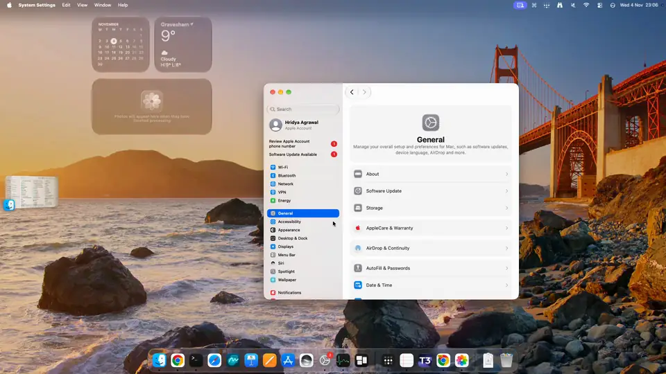
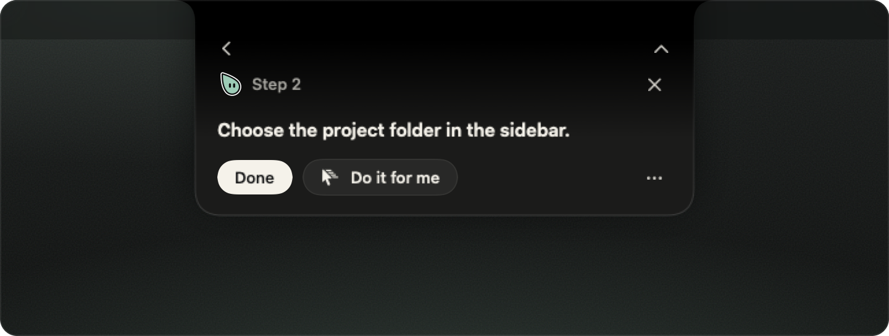
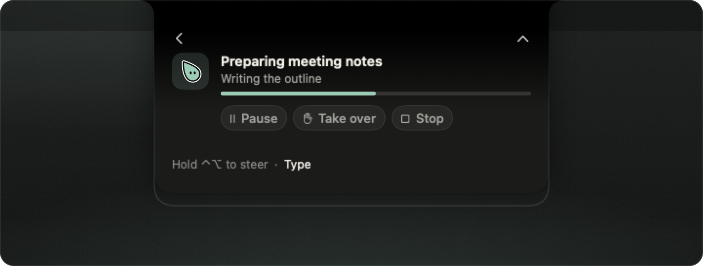
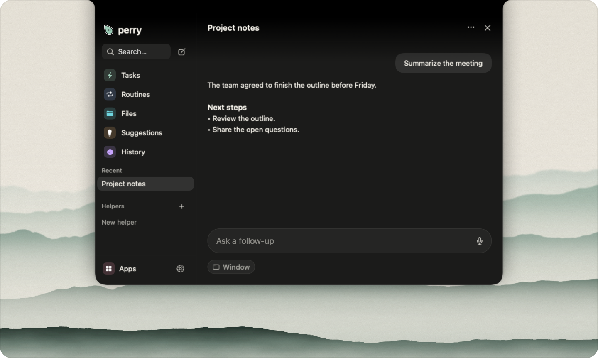
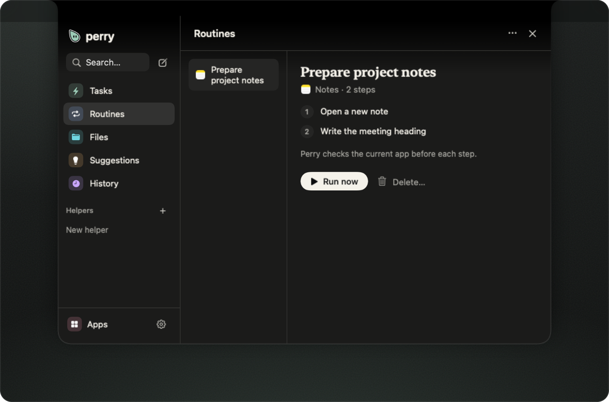

<p align="center">
  <picture>
    <source media="(prefers-color-scheme: dark)" srcset=".github/assets/banner-dark.svg">
    
  </picture>
</p>

<h3 align="center">Ask how to do anything on your Mac.<br>Perry points at the button, or clicks it for you.</h3>

<p align="center">Free and open source. No account. Use the ChatGPT or Claude plan you already pay for, or any API key.</p>

<p align="center">
  <a href="https://github.com/hridaya423/perry/releases/latest"></a>
</p>

<p align="center">
  <a href="https://github.com/hridaya423/perry/releases/latest"></a>
  <a href="LICENSE"></a>
  
  
</p>

<p align="center">
  <a href="#install">Install</a> · <a href="#what-perry-does">Features</a> · <a href="#bring-your-own-brain">Brains</a> · <a href="App/Resources/CHANGELOG.md">Changelog</a> · <a href="https://github.com/hridaya423/perry/issues">Issues</a>
</p>

<br>

<p align="center">
  
  <br>
  <sub>Real screen recording, sped up in places. Perry points at Appearance, then at Dark, then does the last step.</sub>
</p>

Perry opens from the notch at the top of your screen. Hold <kbd>⌃</kbd><kbd>⌥</kbd> and talk, or type. Ask how to do something, and Perry points at each control in the app you have open. Ask Perry to do the task, and it does the work while you watch, with a stop button always in reach.

> [!NOTE]
> Perry is in public beta. Report problems through [Issues](https://github.com/hridaya423/perry/issues).

## What Perry does

<table>
  <tr>
    <td width="50%" valign="top">
      
      <h4>Show me how</h4>
      <p>Perry points at one control, waits for you to click it, then points at the next one. Click <b>Do it for me</b> at any step, and Perry takes over.</p>
    </td>
    <td width="50%" valign="top">
      
      <h4>Do it for me</h4>
      <p>Perry works in the background and logs each action. Pause, take over or stop at any time. Perry asks once before any action that you cannot undo.</p>
    </td>
  </tr>
  <tr>
    <td width="50%" valign="top">
      
      <h4>Ask about your screen</h4>
      <p>Ask a question about the window in front of you. Perry reads it only while you ask, and answers in the notch.</p>
    </td>
    <td width="50%" valign="top">
      
      <h4>Routines</h4>
      <p>Show Perry a task once, and it saves the steps as a routine. Perry checks the current app before each step when it runs one again.</p>
    </td>
  </tr>
</table>

Perry also connects to Slack, Notion, Linear and Google Workspace. Helpers run a job on a schedule, for example a morning summary of your newsletters.

## Bring your own brain

Perry has no account and no subscription. Pick the model that does the thinking in **Settings → Brain**.

| Brain | What you need |
| --- | --- |
| ChatGPT | A ChatGPT plan. Perry runs the bundled Codex runtime. |
| Claude Code | A Claude plan and the Claude Code CLI. |
| API key | A key for OpenAI, Anthropic, Gemini, OpenRouter, xAI, Groq, Cerebras, Mistral, DeepSeek, Together, Fireworks, or any OpenAI-compatible endpoint. |
| On this Mac | Nothing. Perry answers in text until you set up a brain. Local servers such as Ollama also work. |
| ACP agent | Any agent from the Agent Client Protocol registry, such as Gemini CLI or Goose. |

Perry stores API keys in the macOS Keychain.

## Privacy

- Screen capture runs only during a session that you start.
- Perry never reads or acts in banking, password manager or checkout windows.
- Memory starts only after you agree during onboarding. Erase it by category or in full.
- Perry has no server and no telemetry. Requests go only to the brain and the integrations that you choose.

## Install

Perry needs a Mac with Apple Silicon and macOS 14 or later.

1. Download **Perry-0.1.0.dmg** from the [latest release](https://github.com/hridaya423/perry/releases/latest).
2. Open it and drag Perry to Applications.
3. Open Perry. It explains Accessibility, Screen Recording and Microphone access before macOS asks for each one.

The app is signed with a Developer ID and notarized by Apple. Later versions arrive through the built-in updater.

### Build from source

Building also needs Xcode.

```sh
git clone https://github.com/hridaya423/perry.git && cd perry
./scripts/fetch-codex-runtime.sh --fetch
./scripts/fetch-agent-desktop.sh --fetch
./scripts/fetch-cua-driver.sh --fetch
./scripts/fetch-xcodegen.sh --fetch
build/tools/xcodegen/bin/xcodegen generate --spec project.yml
xcodebuild build -project Perry.xcodeproj -scheme Perry -configuration Debug \
  -derivedDataPath build/debug-p1 -destination 'platform=macOS,arch=arm64'
open build/debug-p1/Build/Products/Debug/Perry.app
```

Each fetch script checks its download against the SHA-256 in `scripts/*.lock`.

> [!TIP]
> If macOS forgets the permissions after each rebuild, sign Debug builds with your team identity in `Config/DebugSigning.local.xcconfig`. Git ignores this file.

## How it works

Perry plans with your brain, acts through [agent-desktop](https://github.com/vercel-labs/agent-desktop), and checks the screen after each step. Each session binds to one app and one window. [cua-driver](https://github.com/trycua/cua) delivers the clicks and drags that agent-desktop misses, without moving your cursor. [PRD.md](PRD.md) has the architecture and the trust tiers. [DESIGN.md](DESIGN.md) has the visual language.

<details>
<summary><b>Development</b></summary>
<br>

[`project.yml`](project.yml) generates `Perry.xcodeproj`. Do not edit the project by hand. Add files under `App/` or `Packages/`, then run XcodeGen again.

```sh
swift test --package-path Packages/PerryCore
./scripts/test-release-automation.sh
./scripts/performance/self-test.sh
```

| Path | Contents |
| --- | --- |
| `App/` | The app: notch workspace, onboarding, settings, controllers |
| `Packages/PerryCore` | Shared types, the trust guard, the activity log, Keychain, hotkeys |
| `Packages/PerryBrain` | Model providers, conversation context, the `perry-mcp` server |
| `Packages/PerryRuntimes` | Runtime adapters and the Do supervisor |
| `Packages/PerryGuide` | The guide engine, tasks, routines and per-app notes |
| `Packages/PerryOverlay` | The Perry character, ink strokes and the screen overlay |
| `scripts/` | Runtime fetchers, release tooling and lab drills |

</details>

## License

[AGPL-3.0](LICENSE)
