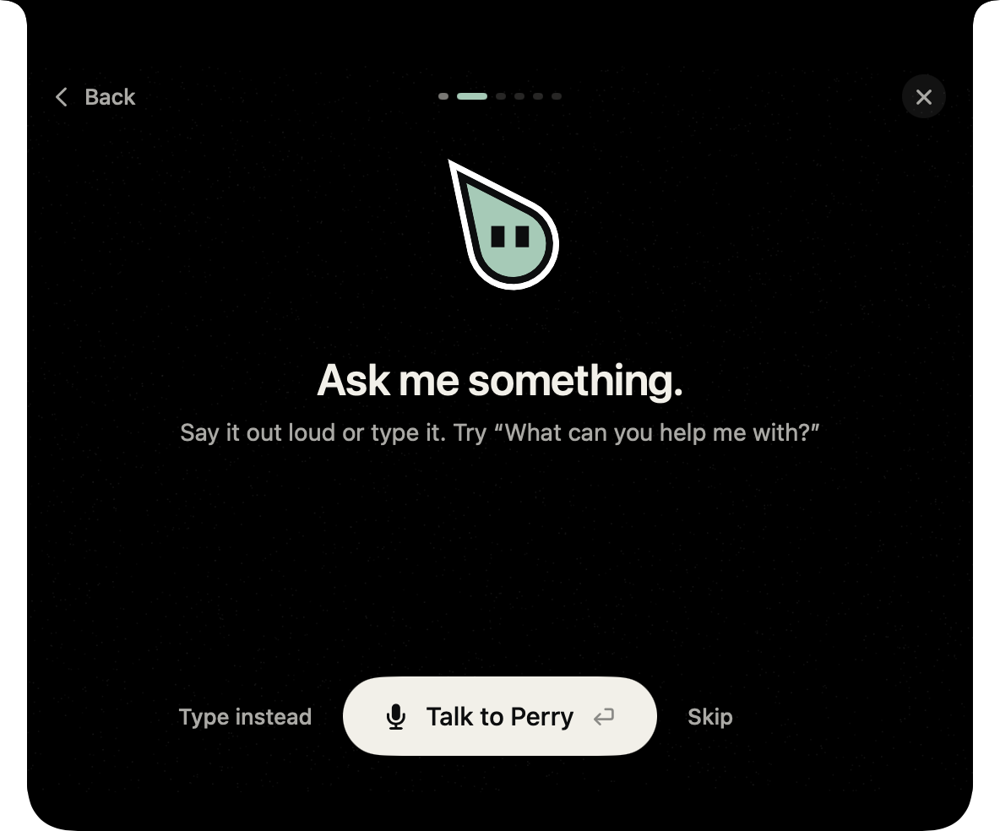

<p align="center">
  <picture>
    <source media="(prefers-color-scheme: dark)" srcset=".github/assets/banner-dark.svg">
    
  </picture>
</p>

<p align="center">A screen-aware companion for macOS that teaches any app by pointing at your screen, written in Swift.</p>

<p align="center">
  <a href="LICENSE"></a>
  
  
</p>

<p align="center">
  <a href="PRD.md">Product contract</a> · <a href="DESIGN.md">Design</a> · <a href="https://github.com/hridaya423/perry/issues">Issues</a>
</p>

Perry lives in the notch of your Mac. Ask it how to do something, and it points at each control in the app you have open, one step at a time. Ask it to do the task, and it does the work in the background, with one clear confirmation before any irreversible action.

<p align="center">
  
</p>

> [!NOTE]
> Perry is in public beta. No signed release exists yet. Build it from source with the steps below.

## What Perry does

- **Guide.** Perry points at one control, waits for you to act, then points at the next one. "Show me everything" draws the full path at once.
- **Do.** Perry does the task in the background and logs each action. Trust tiers gate each action, and Perry never reads or acts in banking, password manager or checkout windows.
- **Talk.** Use the global hotkey, push-to-talk or typed input. Realtime speech is optional. Apple Speech is the fallback.
- **Bring your own brain.** Use the bundled Codex runtime, Claude Code, OpenCode, an ACP agent, eleven cloud presets, a local server or any OpenAI-compatible endpoint. Perry stores API keys in the Keychain.
- **Connect your tools.** Slack, Notion, Linear and Google Workspace connect through direct sign-in.

Screen capture runs only during a session that you start. Memory starts only after you consent during onboarding, and you can erase it by category or in full.

## Install

Perry needs Apple Silicon, macOS 14 or later and Xcode.

```sh
git clone https://github.com/hridaya423/perry.git
cd perry
./scripts/fetch-codex-runtime.sh --fetch
./scripts/fetch-agent-desktop.sh --fetch
./scripts/fetch-cua-driver.sh --fetch
./scripts/fetch-xcodegen.sh --fetch
build/tools/xcodegen/bin/xcodegen generate --spec project.yml
xcodebuild build -project Perry.xcodeproj -scheme Perry -configuration Debug \
  -derivedDataPath build/debug-p1 -destination 'platform=macOS,arch=arm64'
open build/debug-p1/Build/Products/Debug/Perry.app
```

Each fetch script checks the download against the SHA-256 in its `scripts/*.lock` file. A successful build prints `** BUILD SUCCEEDED **`.

On first launch, Perry asks for Accessibility, Screen Recording and Microphone access. It explains each permission before macOS shows the prompt.

> [!TIP]
> If macOS forgets the permissions after each rebuild, sign Debug builds with a team identity. Put it in `Config/DebugSigning.local.xcconfig`. Git ignores this file.

## How it works

Perry plans with a model, acts through [agent-desktop](https://github.com/vercel-labs/agent-desktop), and verifies each step. Perry binds each session to one process and one window. If agent-desktop is not healthy, Perry reports the failure and does not switch to another backend. [cua-driver](https://github.com/trycua/cua) runs beside it and delivers clicks and drags that agent-desktop did not deliver, without moving your cursor.

[PRD.md](PRD.md) has the architecture, the trust tiers and the capability ladder. [DESIGN.md](DESIGN.md) has the visual language and the motion rules.

## Development

[`project.yml`](project.yml) generates `Perry.xcodeproj`. Do not edit the project by hand. Add files under `App/` or `Packages/`, then run XcodeGen again.

```sh
swift test --package-path Packages/PerryCore
./scripts/test-release-automation.sh
./scripts/performance/self-test.sh
```

Run `swift test` for each package: `PerryCore`, `PerryRuntimes`, `PerryOverlay` and `PerryGuide`.

| Path | Contents |
| --- | --- |
| `App/` | The Perry app target: notch workspace, controllers, settings |
| `Packages/PerryCore` | Shared types, the trust guard, the activity log, Keychain, hotkeys |
| `Packages/PerryBrain` | Model providers, conversation context, the `perry-mcp` server |
| `Packages/PerryRuntimes` | Runtime adapters for Codex, CLIs and direct providers, and the Do supervisor |
| `Packages/PerryGuide` | The guide engine, tasks, routines and per-app notes |
| `Packages/PerryOverlay` | The companion character and the screen overlay |
| `scripts/` | Runtime fetchers, release tooling and lab drills |

## License

[AGPL-3.0](LICENSE).
