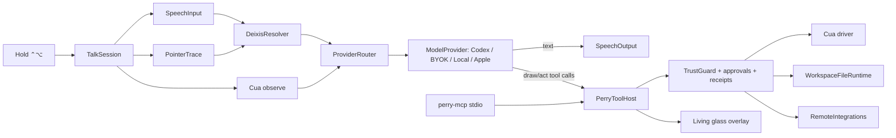

# Perry Megaplan III: Painkiller

Rebuild Perry from a trust-heavy prototype into a Mac companion that is clearly better than HeyClicky. The core promise: hold a key, talk while you point, and Perry sees, speaks, draws, teaches, does, types, remembers, and undoes. It works in any app, sets up in under 90 seconds with ChatGPT sign-in, runs on any model (ChatGPT, BYOK, or local), and is proven by a measured side-by-side scorecard against HeyClicky.

Repository root for all relative paths: `/Users/hridyaagrawal/Honey/perry`. This plan supersedes `plan-12d44888dc540113` (Living Pointer), which the user considers finished. It is a **master plan**. Before each phase starts, the executor writes a task-level sub-plan with the `writing-plans` skill at `docs/plans/2026-MM-DD-phase-N-<slug>.md`, following the interfaces, file lists, and acceptance criteria below. Phases do not start early.

---

## 1. Thesis

HeyClicky proved that people want "a buddy that sees my screen, talks to me, and points." Its weak points are ours to win:

| Their weakness (from the changelog and reviews) | Perry's answer |
|---|---|
| Cloud-only, $20–100/mo quotas (25 free messages) | Free client. **Sign in with ChatGPT** (use your existing plan), or BYOK, or **local models**. No Perry quota. |
| You must *draw* to reference things (spatial context) | **Point while you talk.** Words like "this", "that", and "here" bind to wherever your pointer was when you said them. No drawing mode. |
| Screenshot-coordinate pointing drifts | Pointing is grounded in AX elements, with a pixel fallback checked by `zoom`, so marks stick to the real control and follow window moves. |
| Agent cursor drew over apps and showed in screen shares, then got removed (v1.0.52) | The overlay is excluded from capture (`sharingType = .none`), and the ghost cursor is kept and made safe. |
| No undo for agent work | **"Perry, undo that."** Conflict-safe undo of verified effects. |
| Proactive agents rolled back because users felt watched | Suggestions come only from *connected apps you opt into*. No screen or activity tracking. |
| Stuck notch, stuck "Thinking…", idle CPU up to 45%, freezes | Hard budgets: idle CPU ≤0.5%, every state has an exit ≤10 s, and these are enforced by probes in CI. |
| Skills paused, 89 bulk skills | Teach-once routines plus a small set of hand-written app skills. |

**Promise:** *Hold a key. Talk while you point. Perry sees it, says it, shows it, does it, and can undo it.*

**Definition of done:** the Superiority Scorecard (§9). Perry wins or ties every journey against HeyClicky on the same Mac, and meets every absolute budget (§8).

## 2. Decisions settled with the user

- **Scope:** everything, perfected. That covers Talk, the living cursor and drawing, onboarding, notch Home, Guide, Do/agents, dictation, persistent agents ("Perrys") with routines and suggestions, local models, and failure choreography. The order is feel-first (§6).
- **Model access, open by design:** ChatGPT sign-in through the bundled Codex app-server is the zero-key default. BYOK covers OpenAI, Anthropic, Gemini, and OpenRouter. Any OpenAI-compatible local server works (Ollama, LM Studio, MLX). cua-s1-4b is an experimental local **System-1 grounding chooser**. It scores candidate elements; it is **not** a planner, and it is benchmarked before it can become a default.
- **Do architecture:** a provider-agnostic agent loop. Perry owns one **tool host**. The same tools are exposed natively to direct providers, as Codex *dynamic tools*, and as an **MCP stdio server** for Claude Code, OpenCode, and others. Every call passes Perry's trust guard, approvals, and receipts. The rigid typed-plan-array pipeline is retired for open-ended Do.
- **Persistent agents:** full parity-plus. Named Perrys with memory, threads, files, schedules, and opt-in morning suggestions built from connected apps only.
- **Identity:** a **living glass pointer**. It breathes, reacts to your voice, and morphs between pointer, ring, pen, and caption, drawing with hand-inked strokes. There is no mascot.
- **Home:** the cursor during sessions, plus a **notch Home**. Macs without a notch get a top-center pill. Chats, Perrys, results, files, and Settings all live in Home.
- **Reach:** **any app**, with a protected blocklist (banking, password managers, checkout) refused before capture. Do actions keep the trust tiers.
- **macOS:** runs on 14+. On macOS 26+ it lights up Liquid Glass (`glassEffect`), SpeechAnalyzer STT, and Foundation Models routing. Both paths are first-class.
- **Verification:** the user grants TCC to Perry.app and signs into ChatGPT once at the start. After that the agent drives the real app (cua-driver, screen recordings, latency probes) and delivers video and screenshot checkpoints each phase. HeyClicky is installed for side-by-side benchmarking.
- **Unchanged constraints:** AGPL-3.0, Apple Silicon, no third-party telemetry, local-first data, Keychain secrets, no push or publish without explicit approval, and local commits per reviewed slice.

## 3. Honest baseline: why it feels like a prototype

These come from source and runtime observation made while planning, not from the old goal report.

1. **The reach is broken.** `App/Resources/CuaDriver/capabilities.yaml` allowlists six bundle IDs (Finder, Preview, System Settings, TextEdit, Excel, Resolve) and sets `desktop.display: false`. Ask, Guide, and Do can't touch Chrome, Figma, Slack, Notion, or anything else.
2. **The brain is gated behind Settings.** Ask needs a BYOK vision key (`RuntimeCatalog.makeSpatialAnswerer` reads `byokVisionKeychainAccount`). Without one, it returns a literal list of labels. Onboarding talks about "coding-agent CLIs" and runtimes.
3. **The provider client is single-shot.** `DirectProviderClient.complete` is non-streaming, single-turn, has no tool calling, and is capped at `max_tokens: 768`. You can't get sub-second first tokens or an agent loop from it.
4. **The primary UI is a form.** `SessionPanelView` shows a segmented Ask/Guide/Do picker, a text field, a runtime disclosure, a "Run in background" checkbox, and a status dot. The onboarding is a 7–9 step wizard in a titled `NSPanel` (see `docs/release-readiness/ui/*.jpeg`). This is engineering UI.
5. **Voice is secondary.** Push-to-talk is ⌥⌘Space and feeds dictation into the panel field. The default path is Apple dictation. Realtime voice (`RealtimeVoiceSession.swift`, 2,328 lines) needs an OpenAI key. The hotkey ⌥⌘P opens the form.
6. **The overlay leaks.** `OverlayWindow` sets `ignoresMouseEvents` but never sets `sharingType = .none`, so Perry marks can appear in screenshots and screen shares.
7. **Surfaces are scattered.** There's a panel, activity strip, guide HUD, intent card, tasks window, history window, routine review window, settings window, and notch pill. They don't form a coherent "home."
8. **The god object remains.** `AppController.swift` is 2,150 lines with about 128 functions.
9. **The evidence gap.** `features.json` counts 35 unit-tested, 18 wired, 25 absent, and 1 live-tested. The XCUITest runner hangs in `_dyld_start` on macOS 27 (`.devin/phase0-progress.md`).

**Assets worth keeping:**
- The Cua boundary and pinned driver 0.22.1, which already exposes `get_desktop_state`, `zoom`, `invoke_menu`, `set_value`, `launch_app`, `browser_*`, clipboard, and `verify_state`.
- `TrustGuard` and `ActionPolicyTable`, protected-window checks, `WorkspaceFileRuntime` and `WorkspaceUndoEngine`, receipts and journals, `TaskCoordinator`, `RemoteIntegrations` (Google, Notion, Slack, Linear OAuth), `MemoryStore`, `AppSkillLibrary`, and `LearnedRoutine`.
- Audio route recovery, the Sparkle and release scripts, and the bundled Codex 0.132.0.

**Verified during planning:** Codex 0.132.0 `app-server` supports:
- `account/login/start` with `type: chatgpt` (in-app ChatGPT sign-in), plus `account/read` and `account/rateLimits/read` (a usage meter).
- `thread/start` with dynamic tools (`DynamicToolSpec {name, description, inputSchema}`), where the server sends `DynamicToolCallParams` back to the client.
- `turn/start`, `turn/steer`, and `turn/interrupt`.
- Image `UserInput`.

This is the concrete basis for the one-click brain.

## 4. The experience (north star)

### 4.1 The 90-second first run
1. Open the DMG, then drag to Applications, then launch. There is no window. The **glass pointer fades in beside your cursor** and says (voice plus caption): "Hi, I'm Perry. Hold Control and Option and say hi."
2. You hold ⌃⌥ and say hi. The pointer ripples with your voice, and Perry answers in under a second (on-device on first run, so no account is needed yet).
3. "To see your screen I need two permissions. I'll point at the switches." A System Settings deep link opens, and Perry **points at the exact toggle** using its own Guide engine on System Settings. It detects each grant live, with no "Retry" buttons.
4. "Want me to use your ChatGPT account? One click, no keys." This runs `account/login/start` in the browser, then returns. "Or skip. I'll use this Mac's on-device model."
5. **Hands-on tutorial**, where you do things rather than read about them:
   - Point at something while asking "what's this?" A callout appears on it.
   - "Show me how to…" becomes a 2-step guide in a bundled practice window.
   - "Rename these three files for me" happens in a sandbox folder, then "undo that."
   - Hold the dictation shortcut in a practice text box.
6. The finale tucks into the notch: "I live up here. Hover any time." The total is ≤3 min, first magic arrives ≤90 s, and you never visit Settings.

### 4.2 Talk (the core loop)
- **Hold ⌃⌥** (modifier-only hold, configurable) to talk. Double-tap ⌃ opens the typed composer at the cursor. Both are the same session.
- **On key-down,** within ≤50 ms, the pointer brightens and grows a live waveform ring. In parallel Perry starts capture of the window under the pointer plus a desktop frame (pre-warm), starts streaming STT, and starts a **pointer-trace recorder**.
- **Point-while-you-talk (deixis):** the trace is time-aligned to word timestamps. "What does *this* do" binds to the element under the pointer at "this". "Move *this* … *here*" yields two bindings. A brief ink dot marks each binding as you speak, so you *see* Perry understood. Circling still works, with no mode needed.
- **On release,** a router picks the fast or deep model. First text arrives ≤700 ms p50. Speech is sentence-chunked, with first audio ≤1.0 s p50 on realtime and ≤1.4 s on-device. **Pointing tags stream inline** and draw while Perry speaks: the pointer glides to the element, rings it, and draws an ink arrow or underline, with a caption anchored on the element.
- **Barge-in:** press again or talk over it (with headphones or echo cancellation) to interrupt instantly.
- **Follow-ups** like "the other one", "why?", and "show me" keep context for 10 minutes. "Actually, just do it" hands off to Do in the same thread.
- **Answers live in place.** Callouts follow the window if it moves, fade when the target disappears, and clear on Esc or after reading time.
- **Screen-aware drafting:** "reply saying Thursday works" drafts into the focused field (typed insert, never auto-send).
- **Whole-document context:** "summarize this page/PDF" reads the full document (browser DOM via `browser_*`, PDF text, AX text), not just the visible pixels.

### 4.3 Guide
- "Show me how to add a transition in Resolve" produces up to 25 steps. Each step: the pointer glides, a ring pulses on the control, and a one-line caption plus voice explain it. The step **advances when you do it**, verified against a target-bound postcondition.
- A wrong click gets a gentle nudge ("that's the Effects tab, we want Edit, here"). A missed step leads to a replan from the live screen.
- "Show me everything" paints the numbered path at once.
- "Perry, do this step" or "finish it for me" hands off to Do mid-guide. "I'll do it" hands back.
- The guide keeps its goal across pauses (HeyClicky 1.0.48 had to fix this).

### 4.4 Do (agents)
- Say or type a task. Perry acknowledges, and a **5-second undo-able start** shows the ghost pointer's first move.
- Background work never moves your real cursor or steals focus. A mini card in the notch shows the live step ("Opening Notion… typing title"). Hovering it shows a live thumbnail of what the agent sees.
- Consequential actions (send, delete, purchase, overwrite) show an inline intent card at the target with a single Approve. Red tier requires typed confirmation, as today.
- On finish, you get voice ("Done. Added 5 competitors to your Notion.") plus a result card with files as a pile, **Undo** when available, and follow-up by voice or typing in the card.
- Multiple agents can run in parallel. Each is a thread you can steer ("also add pricing"), pause, or stop.

### 4.5 Dictation
- Hold fn+⌃ (configurable) or double-tap for hands-free. Streamed text shows in a small glass pill at the caret. It's inserted at release, or streamed live on macOS 26.
- Cleanup (punctuation, fillers, no invented words, no em dashes unless spoken), a personal dictionary (edit within 20 s to learn a word), auto language detection, layout-safe insert (Dvorak/Colemak), and terminal newline collapsing. Long sessions get backup, and nothing is lost on interruption.

### 4.6 Perrys (persistent agents), routines, and suggestions
- Home lists your **Perrys**: named agents, each with a job, memory file, thread, folder, and optional schedule (for example "Inbox Keeper", "Launch Scout"). Create one by voice ("make me a Perry that cleans my Desktop every morning") or in Home.
- **Routines:** schedules (wait for wake and network, pause after 3 failures, catch up once) and **teach-once** (Watch & Learn: record, review, replay freshly grounded).
- **Suggestions (opt-in):** each morning a researcher per connected app reads the last 48 h (read-only scopes) and proposes up to 3 cards: "Do it", "Next", or "Adjust". They're quiet on calls, screen share, and Focus, and back off when ignored.
- **Memory:** `PROFILE.md` holds stable preferences and `CONTEXT.md` holds the current project. Both are local, inspectable, and editable in Home, and injected into Talk and agents.

### 4.7 Home (notch)
- **Resting:** an invisible notch, or a slim dot with an unread badge when something is new. **Hover** shows a peek: running agents (live step), unread results, pinned Perrys, and the last answer. **Click or ⌃⌘Space** opens full Home: sidebar (Perrys, Threads, Routines, Suggestions, Settings), a chat thread, and a preview pane for files. It can pop out to a window and remembers its size.
- On Macs without a notch, a top-center pill uses identical content.
- Settings live inside Home as short, plain-language pages: Brain, Voice, Shortcuts, Apps & connectors, Memory & privacy, Perrys, and About. Every control shows a live, verified state.

## 5. Design system v2: living glass

Update `DESIGN.md` (source of truth stays in code: `PerryTheme`, `PerryOverlayTheme`).

- **Pointer:** 26–30 pt asymmetric glass arrow with a mint edge light. It always sits offset down and right of the OS cursor (never covering it) and follows in the **same frame**: an `NSEvent` mouse-moved monitor plus a display-link-driven position, with no animation queueing. It is *alive* but calm: a 4 s breathing edge-light only while a session is active, and fully static when idle.
- **Morph grammar (one shape, meaningful transitions):**
  - Pointer to **listening ring**: the ring radius follows mic RMS at 30 Hz, capped.
  - Pointer to **thinking**: the edge light orbits once per 1.2 s, with no spinner.
  - Pointer to **pen**: when drawing, the tip becomes a nib and strokes come out of it.
  - Pointer to **caption bubble**: the tail anchors to the element.
  - Pointer to **ghost**: an outlined, dashed pointer for agent and rehearsal. It's separate from yours and never covers the target.
  - Pointer to **settle tick**: on done.
  - Pointer to **amber hold**: on blocked.
- **Ink:** hand-inked strokes (variable width, slight jitter, no machine-perfect rectangles). Rings, arrows, underlines, numbered dots, and circles draw on in 180–240 ms and fade out in 400 ms when stale. Ink is mint on dark and deep teal on light, chosen from the sampled background luminance under the target.
- **Glass surfaces:** on macOS 26, `glassEffect(.regular.interactive())` / `GlassEffectContainer` for the composer, captions, cards, and Home. On macOS 14–15, `NSVisualEffectView(.hudWindow/.popover)` with a 1 px inner highlight and a matched corner radius (14 pt on captions, 20 pt on cards). Reduce Transparency makes these opaque, and Increase Contrast adds a 1.5 px edge.
- **Type:** SF Pro Rounded for Perry's voice (captions, titles) and SF Pro for everything else. Caption 15 pt (semibold key noun), max width 340 pt, and dynamic type respected.
- **Motion:** springs only (`.spring(response: 0.32, dampingFraction: 0.86)` for travel, 0.22/0.9 for UI). Entrances ≤260 ms. No layout animation. Reduce Motion removes travel and breathing but keeps opacity cues.
- **Sound:** re-record the 5 cues (wake, send, receive, done, fail) plus 2 new ones (bind: a soft tick when a deixis binding lands; approve), all ≤250 ms. Pre-roll for Bluetooth, and silent on calls.
- **Copy:** `docs/tone-sheet.md` v2: lowercase-friendly and warm but brief. Guide says "this one, next to the red slider." Do says "on it" / "done, 5 rows added." Failures say what happened, what didn't, and one next step. No greetings on every invoke, and no fillers.
- **The anti-reference list:** segmented mode pickers, runtime pickers in the primary flow, "Retry" buttons for permissions, step counters in onboarding, modal windows for non-consequential things, and any status without an exit.

## 6. Architecture v2

### 6.1 Brain layer (new package `Packages/PerryBrain`)
One provider abstraction. It replaces the single-shot paths in `DirectProviderClient`, `BYOKAgentRuntime`, `DirectProviderRuntime`, and `RuntimeGuidePlanner`'s transport. Migrate callers, then delete.

```swift
public struct ModelCapabilities: OptionSet, Sendable { vision, tools, streaming, realtimeAudio, local, longContext }
public enum ModelTier: Sendable { case fast, deep }
public struct ModelRequest: Sendable {
    public var system: String
    public var messages: [ModelMessage]          // text + images (in-memory Data) + tool results
    public var tools: [ToolSpec]                 // JSON-schema tools from PerryToolHost
    public var tier: ModelTier
    public var maxOutputTokens: Int
}
public enum ModelEvent: Sendable {
    case textDelta(String)
    case toolCall(id: String, name: String, argumentsJSON: Data)
    case usage(inputTokens: Int, outputTokens: Int)
    case done(ModelStopReason)
}
public protocol ModelProvider: Sendable {
    var id: ProviderID { get }
    var capabilities: ModelCapabilities { get }
    func stream(_ request: ModelRequest) -> AsyncThrowingStream<ModelEvent, Error>
    func warm() async                            // pre-connect / pre-spawn
}
```

Implementations (each with a recorded-fixture test transport):
- `CodexAppServerProvider`: owns one long-lived `codex app-server` child with `CODEX_HOME` set to Perry's support directory (the existing `CLIRuntime` env filtering pattern). It uses JSON-RPC over stdio. Sign-in uses `account/login/start{type:"chatgpt"}`. It creates threads with `ephemeral: true` for Talk and persistent ones for Perrys, and passes tools as dynamic tools, answering `DynamicToolCallParams` through `PerryToolHost`. `turn/interrupt` handles barge-in, `account/rateLimits/read` feeds the usage meter, and `model/list` picks the fast and deep models.
- `OpenAIResponsesProvider` (SSE streaming, tools, images), `AnthropicMessagesProvider` (SSE, tools, images), `GeminiProvider` (streamGenerateContent), and `OpenAICompatibleProvider` (OpenRouter, Ollama `http://127.0.0.1:11434/v1`, LM Studio, MLX server). They reuse `NetworkEndpointPolicy` (loopback plaintext only) and `KeychainStore`.
- `AppleFoundationModelProvider` (macOS 26+, `FoundationModels`): the fast-tier router and offline fallback for short answers. It never claims vision it doesn't have.
- `ProviderRouter`: picks the provider by capability, user preference, and health; picks the tier using a classifier (Foundation Models on 26, a heuristic on 14: screen-complexity plus question length plus deixis count); and explains fallbacks in one line. It supersedes `RuntimeProviderRegistry` routing (keep its identity and health records).

### 6.2 Tool host (new `Packages/PerryBrain/Sources/PerryTools` + app executors)
One registry is the only way any model affects the world or draws.

```swift
public struct ToolSpec: Sendable { name, description, inputSchema: JSONSchema, tier: ActionTier, surfaces: Set<ToolSurface> }
public protocol ToolExecutor: Sendable { func run(_ call: ToolCall, context: ToolContext) async throws -> ToolResult }
public final class PerryToolHost {                // app-owned; one instance
    func specs(for surface: ToolSurface) -> [ToolSpec]   // .talk (read + draw only), .guide, .agent
    func handle(_ call: ToolCall, context: ToolContext) async -> ToolResult  // validate → TrustGuard → approval → ActionPerformer receipt → execute → verify
}
```

The tool catalog, v1:
- **Observe:** `screen.observe` (window AX + screenshot), `screen.desktop`, `screen.zoom`, `browser.read`, `document.read`, `clipboard.read` (approval required).
- **Draw (Talk/Guide):** `point`, `ring`, `arrow`, `underline`, `caption`, `path(steps)`, `clear`.
- **Act (agent):** `ui.click`, `ui.type`, `ui.setValue`, `ui.menu`, `ui.hotkey`, `ui.scroll`, `ui.drag`, `app.launch`, `browser.navigate/click/type`, `files.*` (existing `WorkspaceFileRuntime`), `integrations.*` (existing `RemoteIntegrations`), `memory.read/write`, `perry.settings.open`, `perry.createPerry`, `perry.schedule`.

Surfaces are enforced: **Talk and Ask get observe and draw only** (this preserves the old "Ask never acts" guarantee structurally). The agent gets everything, subject to tiers.

The **MCP server** is `Perry.app/Contents/Helpers/perry-mcp`, a tiny stdio proxy that connects to the running app over a per-launch authenticated Unix socket and exposes `specs(.agent)`. Claude Code and OpenCode runtimes get it via their MCP config. Codex uses dynamic tools directly.

### 6.3 Agent loop (`AgentLoop` in PerryBrain)
Provider-agnostic: system prompt plus skills plus memory → stream → tool calls → host → results → repeat.
- Budgets: 60 tool calls or 20 min per turn before asking. Steer injects a user message at the next boundary, interrupt cancels, and pause yields at a tool boundary (reusing the `yieldAtBoundary` semantics from `DoSupervisor`).
- Persistence: `ThreadStore` (JSON-lines per thread under Application Support, reusing `TranscriptStore`'s atomic-write and erasure patterns). Screenshots are never persisted.
- The retired pieces are the typed-plan-array execution in `DoSupervisor`, `TypedPlanning`, `ExecutablePlan` enqueue validation for open-ended tasks, and the plan-level rehearsal card. Keep `TrustGuard`, `ActionPolicyTable`, receipts, `WorkspaceFileRuntime`, `WorkspaceUndoEngine`, and `TaskCoordinator` durability as the host's executors. Deletion happens only after every caller has migrated (engineering principle: migrate callers, then delete).

### 6.4 Talk pipeline (`App/Talk/`)
- `TalkSession`: the key-down to done orchestration. It replaces `SessionPanelView` plus the Ask path of `AskSessionController`.
- `PointerTraceRecorder`: a 60 Hz ring buffer of (t, screenPoint, elementUnderPointer via a cached AX hit-test) during the hold. It's memory-only.
- `DeixisResolver`: aligns STT word timestamps with the trace. It maps demonstratives (this, that, here, there, these, it, and 40+ language equivalents) plus pauses to bindings `[Binding(word, time, element?, point, windowID)]`, and sends them as structured context: "(1) 'this' → AXButton 'Export' in Figma at …".
- `SpeechInput`: `SpeechAnalyzerInput` (26+), `SFSpeechInput` (14+, on-device when supported), and `RealtimeInput` (OpenAI key). Each produces words with timestamps.
- `SpeechOutput`: `RealtimeOutput`, `OpenAITTSOutput`, `SystemVoiceOutput` (AVSpeechSynthesizer premium/enhanced voice, sentence-chunked), with speed 0.5–1.5×. Kokoro local TTS is a Phase 9 option.
- `InlineMarkupParser`: a streaming parser for draw tool calls, or for inline tags `⟦ring e17 "Export"⟧` from providers without tools. It validates element IDs against the current observation, and invalid ones are dropped silently from drawing but kept in text.
- Pre-warm: on key-down, `provider.warm()`, audio engine warm, and capture begin. At app launch, spawn the codex app-server and the Cua daemon lazily after first idle second.

### 6.5 Reach (`capabilities.yaml` + `CuaDriverClient`)
- Replace the app allowlist with `apps: any` plus a **Perry-side blocklist** evaluated *before* any capture call. Reuse `GuideTargetValidator.requireUnprotected` with a bundle and URL list for banks, 1Password, Bitwarden, Keychain Access, and checkout URL patterns. Enable `desktop.display: true`. Add `get_desktop_state`, `zoom`, `invoke_menu`, `set_value`, `launch_app`, `browser_*`, `clipboard_*`, and `get_cursor_position` to the allow list. Verify the manifest schema supports "any" against driver 0.22.1 `manifest` docs first. If it doesn't, generate the allowlist dynamically from `list_apps` at session start.
- Every Perry window: `sharingType = .none`, `collectionBehavior = [.canJoinAllSpaces, .fullScreenAuxiliary, .stationary, .ignoresCycle]`. Stay out of the way on ⇧⌘4/5 (hide overlays on screenshot hotkeys, as HeyClicky had to).

### 6.6 App shell decomposition
`AppController` becomes a composition root only (≤400 lines). Extract `TalkCoordinator`, `HomeController`, `AgentCoordinator`, `DictationCoordinator`, and `OnboardingDirector`, each owning its window(s) and state. `SessionController` stays the single interaction state machine, extended with `.talking`, `.agentRunning(threadID)`, and `.dictating`.

### 6.7 Data flow



## 7. Phases

Every phase runs the same loop: sub-plan (`writing-plans`) → failing behavioral checks → implement → focused tests → **live drill on the real app driven by cua-driver, with screen recording** → full diff review → evidence in `docs/evidence/phase-N/` → local commit(s). Implementation and mechanical verification are delegated. Design, safety, and review stay with the lead. Never lower a gate to pass.

### Phase 0: Laboratory, spikes, baseline
**Goal:** instruments before work (`agent-laboratory` skill).
1. Housekeeping. Supersede the old goal (the user runs `/goal clear`, then a new goal is set to this plan). Create `AGENTS.md` with verified build and test commands:
   - `build/tools/xcodegen/bin/xcodegen generate --spec project.yml`
   - `xcodebuild build -project Perry.xcodeproj -scheme Perry -derivedDataPath build/debug-p1`
   - `swift test --package-path Packages/<pkg>`
   - the XCUITest-hang note, and "never hand-edit Perry.xcodeproj."
2. **Live app lane:** build, launch `build/debug-p1/.../Perry.app`, and the user grants Accessibility and Screen Recording once. Add `scripts/lab/perry-drive.sh`, which uses `cua-driver call` to launch Perry, press hotkeys, and read windows, plus `scripts/lab/record.sh`, which uses `screencapture -v` with a timestamped mp4 into `docs/evidence/`.
3. **Latency probe:** `PerformanceSampleLog` gains signposts (`os_signpost`) for key-down, capture done, STT final, first token, first audio, and first draw. `scripts/lab/latency-report.py` summarizes p50/p95 from the log. Idle CPU and memory come from `scripts/lab/idle-probe.sh` (`top -l` / `ps` sampling for 60 s).
4. **Spike: Codex app-server.** A throwaway harness `scripts/lab/codex-appserver-spike.swift` does initialize, ChatGPT login, `thread/start` (ephemeral, one dynamic tool), and `turn/start` with an image. Record time-to-first-delta for the fast and deep models. **Decision gate:** if first-delta p50 is >1.5 s, the Talk fast path uses Apple Foundation Models (26+) or on-device for the acknowledgement plus the draw, with Codex streaming the substance.
5. **Spike: deixis feasibility.** Confirm word timestamps from SFSpeechRecognizer (`SFTranscriptionSegment.timestamp`) and SpeechAnalyzer. Confirm AX hit-test cost at 60 Hz through Cua `get_window_state` caching versus a single cached tree plus a geometric hit-test (preferred, with no per-frame IPC).
6. **Spike: reach.** Validate a capabilities manifest with any-app plus blocklist on driver 0.22.1, and observe Chrome, Figma, and Slack.
7. **HeyClicky baseline:** install the latest DMG (the user signs in on the free tier) and run the 12 scorecard journeys (§9) on both apps. Record videos and measurements into `docs/evidence/scorecard/baseline.md`.

**Gate:** latency probe, recorder, and idle probe work on the real app. Spike results are written up with decisions. Baseline scorecard captured.

### Phase 1: Brain layer and the one-click brain
**New:** `Packages/PerryBrain` (`ModelProvider`, providers, `ProviderRouter`, `ToolSpec`, and a JSON-RPC client for the app-server). **Modify:** `project.yml` (add package), `RuntimeCatalog.swift`, `RuntimeInventory.swift`, `CLIRuntime.swift` (reuse env filtering), and `KeychainStore` callers. **Delete after migration:** single-shot paths in `DirectProviderClient`, `BYOKAgentRuntime`, and `DirectProviderRuntime`.
1. SSE streaming providers (OpenAI Responses, Anthropic, Gemini, OpenAI-compatible) with images and tools, tested with recorded fixtures (no network in unit tests).
2. `CodexAppServerProvider`: process lifecycle (spawn lazily, restart with backoff, kill on quit), login, threads, dynamic tools, interrupt, rate limits, and model list. Test with a fake app-server script that speaks the JSON-RPC schema generated from `codex app-server generate-json-schema`, committed as a fixture.
3. `AppleFoundationModelProvider` behind `if #available(macOS 26, *)`.
4. `ProviderRouter` with an explanation string, and health that marks a provider unhealthy after 2 consecutive failures for 60 s.
5. Local servers: auto-detect Ollama (`127.0.0.1:11434/api/tags`) and LM Studio (`:1234/v1/models`), and list vision-capable models.

**Acceptance:**
- With only ChatGPT sign-in, a question with a screenshot streams an answer, and first-delta is measured.
- With only an Ollama vision model, the same works offline.
- Pulling the network mid-stream produces a clean error and an idle state within 2 s.
- All provider unit tests pass. `swift test --package-path Packages/PerryBrain` is green.

### Phase 2: The Talk loop (hero)
**New:** `App/Talk/TalkSession.swift`, `PointerTraceRecorder.swift`, `DeixisResolver.swift` (pure, in PerryBrain for testability), `SpeechInput*.swift`, `SpeechOutput*.swift`, `InlineMarkupParser.swift` (PerryBrain), and `ModifierHoldMonitor.swift` (⌃⌥ hold, double-tap ⌃, using a listen-only CGEventTap with `flagsChanged`). **Modify:** `VoiceController.swift` (shrinks to device/route management), `PushToTalkController.swift` (replaced by `ModifierHoldMonitor`, then deleted), `RealtimeVoiceSession.swift` (adapted as `RealtimeInput/Output`), `AudioRouteMonitor.swift`, `AskSessionController.swift` (logic folded into `TalkSession`, then deleted), and `SessionController.swift` (`.talking`).
1. Key-down: visual response within ≤50 ms, parallel capture, STT, and trace.
2. The deixis resolver has unit tests covering: a single "this", two bindings with "this … here", no pointer movement meaning a window-level reference, a pointer on Perry's own overlay being ignored, a stale element (window moved) re-resolved by frame, multilingual demonstratives (en, es, fr, de, hi, ja, zh), and a pause-before-word offset of ±250 ms.
3. Prompt contract: the system prompt includes observation elements as compact IDs, the bindings, memory, and the app skill. The model draws via tools or inline tags and speaks in short sentences.
4. Streaming TTS by sentence, with barge-in (key press or VAD when echo-cancelled) that cancels the provider turn and speech within ≤150 ms.
5. Follow-up context for 10 min per app window. "New topic" or 10 min idle resets it.
6. Ask-never-acts is enforced by tool surface `.talk`. A test sends a malicious model tool call `ui.click` in Talk and asserts it's rejected and logged.
7. Typed composer (double-tap ⌃): a glass field at the cursor with the same pipeline, text response in a caption, and ⌘C to copy.

**Acceptance (live, recorded):**
- In Figma, Chrome, Finder, Resolve, and Slack, pointing at a control while saying "what does this do?" produces a correct answer with a ring on the right element.
- p50 first audio ≤1.0 s (realtime) / ≤1.4 s (system voice). p50 first draw ≤1.5 s.
- Barge-in works.
- Scorecard J2 and J12 beat or tie HeyClicky.

### Phase 3: Living glass cursor and ink
**Modify:** `PerryGlassCursor.swift` (morph states), `OverlayWindow.swift` (split: `OverlayWindow` hosting, `CursorFollower`, `InkLayer`, `CaptionLayer`, and `GhostCursor`; delete the legacy buddy navigation, scribble, and spinner code after migration), `PerryTypes.swift`, `GuidanceModels.swift` (ink primitives), `PerryTheme.swift`, and `DESIGN.md`.
1. Same-frame follow via display link. Idle means zero timers (verified by the idle probe).
2. Morph grammar (§5) with interruptible springs, and Reduce Motion variants.
3. Hand-inked stroke renderer: a variable-width path from a centripetal Catmull-Rom spline with seeded jitter, draw-on via `trim`, and luminance-adaptive ink color (sample a 24×24 patch from the last observation, no extra capture).
4. Caption placement solver: avoid the target, the caret, screen edges, the menu bar, the Dock, and the notch, with multi-display negative origins. Reanchor on window move (Cua window frame polling at 10 Hz only while marks are visible).
5. Every overlay uses `sharingType = .none`, hides on screenshot hotkeys, and hides during detected screen share (`CGWindowListCopyWindowInfo` for known share indicators, or `SCShareableContent` on 14+).
6. Debug gallery (`DebugCursorGallery.swift`) renders every state on light, dark, and busy backgrounds at 1× and 2× for snapshot evidence.

**Acceptance:** snapshots of all states; a 120 Hz recording shows zero visible lag behind the OS cursor; idle CPU ≤0.5%; Perry is not visible in a `screencapture -w` of any window; Reduce Motion, Transparency, and Contrast pass.

### Phase 4: Onboarding as the first magic
**Replace:** `OnboardingWindow.swift` and `OnboardingFlow.swift` with `App/Onboarding/OnboardingDirector.swift` (a script of beats driven by the Talk pipeline and overlay), plus a bundled `PracticeWindow` (a local SwiftUI window with fake controls, files, and a text box). **Modify:** `DemoDirector.swift` (folded in), `EnvironmentProbe.swift`, and the Info.plist usage strings (warm and specific). Opt out of Automatic Termination (`ProcessInfo.disableAutomaticTermination`), since HeyClicky lost setups to this.
1. The beats from §4.1. Permission grants are detected by polling `AXIsProcessTrusted` and `CGPreflightScreenCaptureAccess` every 500 ms while the beat is active. Perry points at the System Settings toggle (Guide engine on System Settings, which is now reachable).
2. Brain choice: ChatGPT (primary button), "Use this Mac" (on-device), and "I have a key / local model" (link). Can be skipped at any point.
3. Every beat can be done by voice or keyboard. Skippable. Replay available in Settings.
4. On failure (denied mic, no network), the beat adapts. Nothing dead-ends.

**Acceptance:** the agent-driven fresh-user run (`tccutil reset` for Perry, fresh support directory) reaches first answer in ≤90 s and completion in ≤3 min, with zero Settings visits beyond the TCC toggles. Recorded. Beats HeyClicky on J1.

### Phase 5: Notch Home
**New:** `App/Home/HomeController.swift`, `HomePeekView.swift`, `HomeView.swift` (sidebar, thread, preview), `HomeSettings/*.swift` (migrating `SettingsView.swift` sections into plain pages), and `ThreadStore` (PerryBrain). **Evolve:** `NotchStatusController.swift` into the resting and peek host. **Delete after migration:** `HistoryWindow.swift`, `BackgroundTasksWindow.swift`, `SettingsView.swift` (as a window), `WhatsNewWindow.swift` (becomes a Home card), and the menu-bar-only surfaces (keep a minimal menu bar item behind a setting for Macs without a notch that want it).
1. Notch geometry from `NSScreen.safeAreaInsets` / `auxiliaryTopLeftArea`, with a pill fallback. Hover intent delay of 120 ms, tuck-away 250 ms after exit, Esc closes and stays closed until the pointer leaves.
2. Peek: running agents with a live step, unread results (badge), pinned Perrys, and the last answer.
3. Full Home: resizable from the edges, pop-out window that remembers its frame, selectable reply text, drafts kept per thread, and files as piles that can be dragged out.
4. Settings pages with live verified state (Brain shows the signed-in account plus a rate-limit meter; Voice has previews; Shortcuts has a recorder; Apps & connectors; Memory & privacy with erase; Perrys; About/updates inline).

**Acceptance:** hover, peek, and open ≤120 ms; no stuck-open states (fuzzed pointer paths in a UI drill); idle CPU with Home closed is unchanged; all previous windows' functions are reachable in Home.

### Phase 6: Guide, perfected
**Modify:** `GuideSessionCoordinator.swift`, `GuideEngine.swift`, `GuidePlan.swift`, `RuntimeLadder.swift` (the transport moves to PerryBrain; keep strict decoding and `GuideDecision`), `ClickAdvanceObserver.swift`, `GuideControlsWindow.swift` (replaced by inline caption controls: Back, Skip, "Do this step", Stop), and `AppSkillLibrary` (hand-write 12 skills for the scorecard apps: Resolve, Figma, Excel, Sheets, Notion, Slack, Chrome, Finder, Keynote, Final Cut, Logic, System Settings).
1. Step budget of 25, goal and completed steps persisted across pauses, and replan on a deviation from the live screen.
2. Wrong-click nudge copy, and "show me everything" path painting.
3. Mid-guide handoff to the agent (same thread) and back.
4. Canvas apps (Figma, Resolve) where AX is sparse: `screen.zoom` plus a pixel point, verified by a second zoom crop around the proposed point. Optionally the cua-s1 chooser (Phase 9).

**Acceptance:** scorecard J3 and J5 complete end to end on live apps, with ≥95% of steps pointing at the correct control (AX apps) and ≥85% (canvas apps), measured over 20 recorded runs.

### Phase 7: Agents and Do via the tool host
**New:** `PerryToolHost` plus executors (`App/Tools/*.swift`: `ScreenTools`, `DrawTools`, `UITools`, `BrowserTools`, `FileTools` wrapping `WorkspaceFileRuntime`, `IntegrationTools` wrapping `RemoteIntegrations`, `MemoryTools`, and `PerryTools`), `AgentLoop` (PerryBrain), `App/Agents/AgentCoordinator.swift`, and the `perry-mcp` helper target in `project.yml`. **Modify/migrate:** `ForegroundTaskController.swift` and `BackgroundTaskController.swift` collapse into `AgentCoordinator`; `TaskCoordinator` stays the durable record owner; `IntentCardWindow.swift` becomes an inline intent card anchored at the target; `AgentActivityStrip.swift` becomes the notch mini-card. **Delete after migration:** typed-plan execution paths (`DoSupervisor` plan arrays, `TypedPlanning`, and `ExecutablePlan` open-ended enqueue), `RehearsalMarks`, and `DebugInvocationPrototypes`.
1. Tool specs with JSON schemas, tiers from `ActionPolicyTable`, and unknown-effect GUI input defaulting to orange review. The model can't lower a tier.
2. Execution ordering through `ActionPerformer` (persist prepared → dispatch → verify → persist outcome). A persistence failure before dispatch means nothing runs.
3. Ghost cursor for agent actions in the overlay, with the real pointer never moved and focus never stolen (Cua background input).
4. 5-second start window; steer, pause, stop; parallel agents with a per-resource claim (existing `BackgroundTaskResource`).
5. Result cards with a file pile, Undo (verified inverses only, existing engine), and voice or typed follow-up.
6. `perry-mcp`: an authenticated socket (random token file with 0600 permissions in the Perry support directory). Claude Code and OpenCode runtimes auto-configured to use it.
7. Per-thread computer-use consent: "Allow once / Always for this Perry / Not now" (HeyClicky 1.0.52's lesson).

**Tests:**
- Every tool validates its schema and rejects unknown keys.
- A Talk-surface agent call is rejected.
- A red action is never executed without typed confirmation.
- A crash between dispatch and verify leaves the thread uncertain and never replays.
- MCP over a socket without the token is refused.
- Two agents contending for one resource are serialized.

**Acceptance:** J6 (Finder plus Undo), J9 (background research into Notes or Notion while the user keeps working, with the real cursor untouched, verified by recording plus a `get_cursor_position` trace), and J7 (draft reply, never sent) pass live.

### Phase 8: Dictation
**Modify:** `DictationController.swift` (streamed input via `SpeechInput`, cleanup via the fast-tier provider with a strict "never add words" prompt plus a diff guard that rejects cleanup outputs whose token-level edit distance exceeds a threshold), `VoiceTextNormalizer.swift`, `SpeechLanguageDetector.swift`. **New:** `DictationPill` (glass at the caret, with the caret found via AX `kAXBoundsForRangeParameterizedAttribute` and a fallback to the pointer), `PersonalDictionary` (learn on edit within 20 s by reading back the field via AX), and an insertion strategy chain (AX `kAXSelectedText` set → layout-safe synthetic typing → clipboard paste with restore and `org.nspasteboard.TransientType` so clipboard managers skip it).
- Terminal detection (bundle IDs) collapses newlines. Local backup of every final transcript for 7 days (erasable). Interruption keeps the partial text.
- Screen-aware drafting ("reply to this…") routes to Talk with `.draftInsert`.

**Acceptance:** J8. Release-to-text ≤450 ms p50 on 26+ (SpeechAnalyzer) and ≤700 ms on 14. Insertion works in Slack, VS Code, Chrome, Notes, Mail, WeChat, and Terminal (recorded matrix). No invented words across a 30-sample fixture set.

### Phase 9: Perrys, routines, suggestions, local models
**New:** `App/Perrys/PerryStore.swift` (name, job, memory, thread, folder, schedule), `RoutineScheduler.swift` (NSBackgroundActivityScheduler plus wake and network gating, pause after 3 failures, catch up once), `SuggestionEngine.swift` (per-connector read-only researchers into a ranked set of 3 cards; quiet on call, screen share, or Focus via `INFocusStatusCenter`; backoff), `MemoryFiles` (`PROFILE.md`/`CONTEXT.md` over the existing `MemoryStore` consent model), and custom MCP connectors (user adds a URL or command; tools are listed and gated like integrations). **Modify:** `LearnedRoutine.swift`, `RoutineReplay.swift`, `DemonstrationRecorder.swift`, `RoutineLibraryController.swift`, `RoutineReviewWindow.swift` (the review moves into Home), and `WakeWordListener.swift` ("hey Perry" as an opt-in wake).
- Name generator (two words that say the job), and voice creation of up to 5 Perrys at once.
- Local models: a Home "Brain" page with detected local servers, a model picker per tier, and honest quality notes. **cua-s1 experiment:** `scripts/lab/cua-s1-sidecar/` (Python, MLX or Transformers) serving `/choose` over loopback, used by Guide and agent grounding as an optional chooser over candidate elements. Benchmark it on 200 recorded grounding cases from Phases 2, 6, and 7 against the frontier model, and enable it only if accuracy is ≥ frontier −3 pts with lower latency. Optional Kokoro local TTS the same way.

**Acceptance:**
- Create a Perry by voice, schedule it, and a routine runs after wake while offline-then-online.
- Teach-once replay (J10) passes.
- Suggestions only use connected-app read scopes (asserted by an integration policy test), and none appear during a call.
- The local-only mode (Ollama plus on-device voice) completes J2 offline.

### Phase 10: Failure choreography and final polish
- An audit of every state for a visible exit ≤10 s (a state machine test enumerates `SessionController` states × events).
- Audio: Bluetooth pre-roll, mic failover to built-in with a notch explanation, muted speaker copying the answer to the clipboard with an Unmute button, pro interfaces (sample-format conversion), and route flips mid-answer.
- Network: offline, region-blocked, provider 429 with a rate-limit card and reset time from `account/rateLimits/read`, captive portal. Sleep and wake, display reconnect, Spaces and fullscreen, Stage Manager, multiple displays.
- In-app "Report a problem" (redacted local diagnostics bundle, user-initiated), a What's-new card after update, and changelog in Home.
- Copy pass with `clean-copy` and `prose`, design review with `design-review` and `emil-design-eng`, and a code deslop pass with `code-deslop`.
- Performance soak: 8 h idle plus 200 Talk turns, with no leaks (memory growth <30 MB) and idle CPU ≤0.5%.
- Final scorecard run (§9), with release docs updated (`README.md`, `PRD.md` v2, `docs/capabilities.md`, `features.json` statuses backed by evidence).

## 8. Absolute budgets (enforced by lab probes)

| Metric | Budget |
|---|---|
| Key-down → visible listening | ≤50 ms p95 |
| Release → first text | ≤700 ms p50 / ≤1.5 s p95 (fast tier) |
| Release → first audio | ≤1.0 s p50 realtime; ≤1.4 s system voice; ≤2.0 s p95 |
| Release → first ink on target | ≤1.5 s p50 |
| Cursor follow lag | ≤1 frame at display refresh |
| Barge-in → silence | ≤150 ms |
| Idle CPU / RSS | ≤0.5% avg over 60 s / ≤180 MB |
| Home hover → peek | ≤120 ms |
| Dictation release → text | ≤450 ms (26+) / ≤700 ms (14) |
| First run → first answer / done | ≤90 s / ≤3 min, 0 Settings visits beyond TCC |
| Pointing accuracy | ≥95% AX apps, ≥85% canvas apps |
| Stuck states | 0. Every state has an exit ≤10 s |

## 9. Superiority Scorecard (definition of done)

Run on this Mac (M4 Pro, macOS 27), HeyClicky latest vs Perry, same prompts, 3 runs each, recorded. Scored on success, time-to-first-audio, time-to-done, pointing accuracy, and interventions needed. Stored in `docs/evidence/scorecard/phase-N.md` after Phases 0, 2, 4, 6, 7, 8, and 10.

1. **J1** Fresh install → first answered spoken question.
2. **J2** Figma: point at a control, "what does this do?"
3. **J3** Resolve: "how do I add a cross-dissolve?" as a full walkthrough.
4. **J4** Chrome: "summarize this page" (a long article).
5. **J5** Sheets or Excel: "format this column as currency" as a guide, then "just do it".
6. **J6** Finder: "put today's screenshots in a folder called Shots", then "undo that".
7. **J7** Gmail: "reply saying Thursday works" (draft only).
8. **J8** Dictation: a 30 s ramble into Slack.
9. **J9** Background: "find 5 competitors of Linear and put them in a Notes doc" while the user types elsewhere.
10. **J10** Teach once: "export as PDF to Desktop", replayed by voice.
11. **J11** Chaos: AirPods yanked mid-answer, Mac muted, Wi-Fi off, then on.
12. **J12** Barge-in plus "no, the other one" follow-up.

**Win condition:** Perry wins or ties all 12, and wins outright on at least 8. Any loss produces a named follow-up task before the megaplan closes.

## 10. Verification protocol

- **Unit:** `swift test --package-path Packages/{PerryBrain,PerryGuide,PerryRuntimes,PerryCore,PerryOverlay}`, plus `xcodebuild test -project Perry.xcodeproj -scheme Perry -derivedDataPath build/debug-p1 -only-testing:PerryTests/<Suite>` for focused app suites. The full suite runs once per phase gate.
- **Live:** agent-driven via `cua-driver` (the `cua-driver` skill), with a screen recording per acceptance item and latency and idle probe reports. XCUITest stays parked while the macOS 27 runner hang persists. If it resolves, snapshot fixtures come back.
- **Review:** each phase diff gets the `code-review` lens plus `thermo-nuclear-code-review` on architectural phases (1, 2, 7). UI phases get `design-review`, with evidence screenshots and videos linked in the phase evidence doc.
- **Evidence registry:** `docs/release-readiness/features.json` statuses move only with linked recorded evidence (`live-tested` requires a recording path).

## 11. Risks and mitigations

- **Codex app-server is experimental and version-pinned.** Keep it pinned (`scripts/codex-runtime.lock`), use a schema fixture test so upgrades fail loudly, and keep BYOK and local as equal alternatives.
- **ChatGPT-login latency may miss Talk budgets.** The Phase 0 gate decides the hybrid fast path (on-device acknowledgement plus draw first). This is stated honestly in the Brain page.
- **Any-app reach expands risk.** The blocklist is evaluated before capture. The Talk surface can't act. The agent is tiered with receipts. Integration writes stay off by default.
- **Deixis misbinding.** Show the binding dot live. The spoken answer names the element ("the Export button…"). "No, the other one" rebinds to the next candidate.
- **The macOS 14 vs 26 split doubles UI states.** Both are covered in the debug gallery snapshots. Feature detection is centralized in `PlatformFeatures.swift`.
- **Scope size.** Sub-plans per phase, feel-first ordering, and each phase shippable on its own. Delete superseded code in the same phase that replaces it to avoid dual paths.
- **cua-s1 is research-grade** (Python/LoRA). It's a sidecar experiment only. It never blocks a phase, and it's a default only if the benchmark says so.
- **Disk and build time.** Reuse `build/debug-p1` DerivedData, and avoid clean builds.

## 12. Out of scope

A Perry hosted backend, accounts, billing, or referral system. Windows or Linux. Ambient screen or activity monitoring. A hosted marketplace (import and export of routines and skills via files is in). Teams. Auto-send of email or messages. Kid voices and character packs.

## 13. Execution notes for the implementing agent

- Start each phase by writing its sub-plan (`writing-plans`) with exact files, full code, and commands. Implement task by task (`executing-plans`), and delegate mechanical work.
- Follow repository conventions. XcodeGen generates the project, so add files under `App/` or `Packages/` and regenerate; never hand-edit `Perry.xcodeproj`. No new third-party dependencies without explicit approval (everything above uses system frameworks plus the already-bundled Codex and Cua).
- Commit per reviewed slice with the "why" in the message and the Devin co-author trailer. No push.
- Ask the user only for: TCC grants, ChatGPT sign-in, the HeyClicky install sign-in, connector OAuth test accounts (Phase 7 and 9), and any new dependency.
